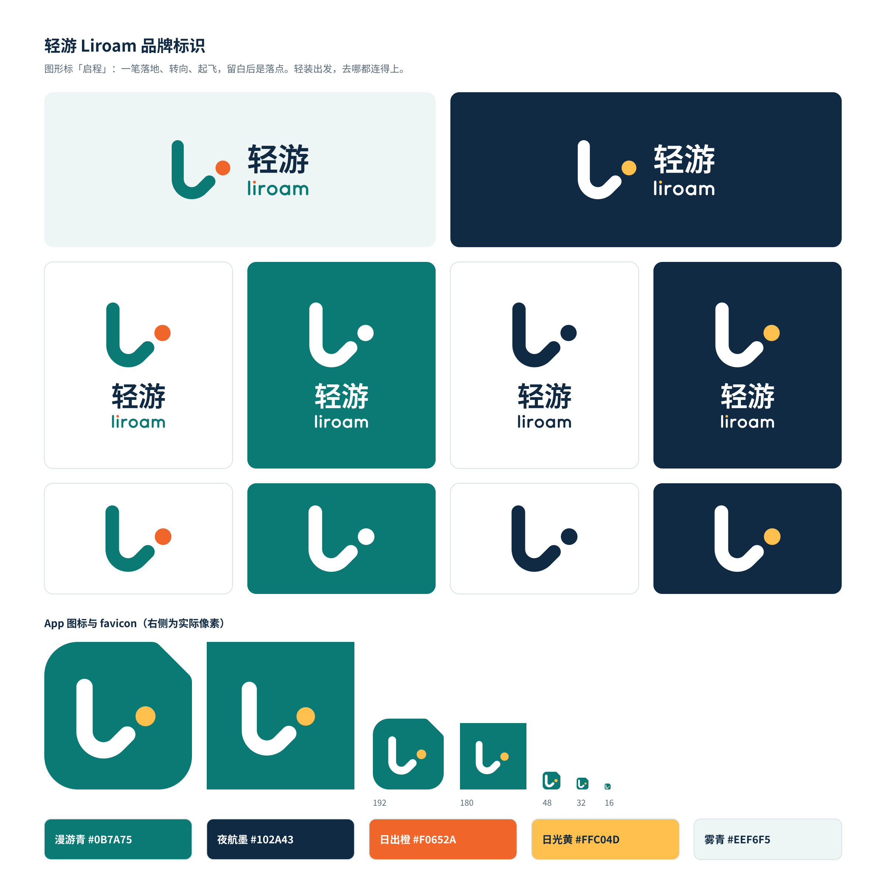
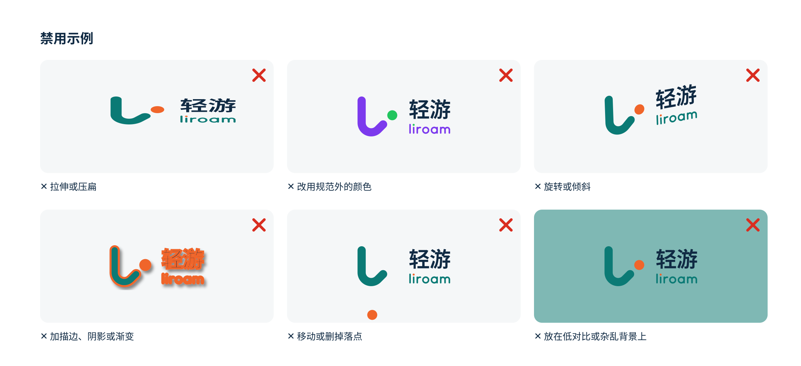

# 轻游 Liroam 品牌标识规范



## 1. 图形标「启程」

一笔从上落地，圆弧转向，斜上起飞，留一段白之后是落点。

- 竖笔落地、整体轮廓是小写 **l**（Liroam 的首字母），也是「出发」。
- 转向起飞的那一段是漫游航迹；落点是目的地，也是「到哪都在线」的信号点。
- 只有一笔一点：轻装、简单。粗细恒定、圆头、全由直线与正圆弧构成：稳定、可信。
- App 图标底板右上角是 SIM 卡切角，对应「一张张卡」的资产感；底板只用于图标场景，不进组合标。

英文字标 `liroam` 为同一套圆头等宽单线手绘几何字，与中文等宽对齐；i 的点与图形标落点同色，是全套标识里唯一的暖色。

方向提案与取舍见 [`preview/concepts.png`](preview/concepts.png)：A「启程」定稿；B「卡角地球」语义直白但与通用电信 / 网格图标雷同、16px 下纬线糊成一片；C「轻翼」纸飞机是旅行行业通用符号，且与 Telegram 撞形。

## 2. 色彩

| 名称 | 角色 | HEX | RGB | 说明 |
|------|------|-----|-----|------|
| 漫游青 | 主色 | `#0B7A75` | 11 122 117 | 图形标、英文字标、App 底板；与白对比 5.2:1 |
| 夜航墨 | 文字 / 深底 / 单色 | `#102A43` | 16 42 67 | 中文字标、单色版、深色背景 |
| 日出橙 | 浅底落点 | `#F0652A` | 240 101 42 | 只用于浅色背景上的落点与 i 点 |
| 日光黄 | 深底落点 | `#FFC04D` | 255 192 77 | 只用于漫游青 / 夜航墨背景上的落点与 i 点 |
| 雾青 | 浅背景 | `#EEF6F5` | 238 246 245 | 版面浅底 |

落点色随背景换：浅底用日出橙，深底用日光黄；同一画面不混用。暖色只出现在落点与 i 点，不扩大到其它元素。

## 3. 版本与选用

| 版本 | 文件（`svg/`） | 用在哪 |
|------|----------------|--------|
| 横版组合 | `liroam-horizontal-{color,reverse,mono,white}.svg` | 默认首选：网站页头、宣传物、合同抬头 |
| 竖版组合 | `liroam-vertical-{…}.svg` | 方形或竖向版面：启动页、海报、包装、实体卡背 |
| 图形标 | `liroam-mark-{…}.svg` | 空间受限、品牌已在上下文出现时：头像、角标、水印 |
| App 图标 | `liroam-app-icon.svg` | 网页 / Android / 宣传里的应用图标（自带 SIM 切角底板） |
| App 图标满版 | `liroam-app-icon-fullbleed.svg` | 提交 iOS / 小程序等会自行裁圆角的平台 |
| favicon | `favicon.svg`、`png/favicon.ico` | 浏览器标签；图形标在底板内放大，16px 可辨 |

配色后缀：`color` 浅底彩色（默认）；`reverse` 深底彩色（白 + 日光黄落点，用于漫游青 / 夜航墨底）；`mono` 单色夜航墨（单色印刷、传真、压印可改为纯黑 `#000000`）；`white` 单色反白（照片或品牌色底）。

## 4. 字体与授权

| 用途 | 字体 | 授权 |
|------|------|------|
| 中文字标「轻游」 | 思源黑体 Noto Sans SC，可变字重取 wght 620，字距 −0.02em，**已转曲** | SIL Open Font License 1.1：可免费商用，可嵌入、可转曲做标识；不得单独出售字体文件 |
| 英文字标 `liroam` | 无字体：本标识手绘几何字（`tools/build.py` 中构造） | 归轻游所有，无第三方授权 |
| 配套排版（页面、物料正文） | 中文思源黑体 / Noto Sans SC；西文与数字可用 Inter | 均为 SIL OFL 1.1，可商用 |

所有 SVG 均为纯路径，不含 `<text>`、不含嵌入位图，不依赖用户本机字体。

## 5. 安全区与最小尺寸

**单位 x = 图形标竖笔宽度**（= 图形标高度 × 0.2045）。

- 安全区：任何版本四周至少留 **1x** 空白，不放文字、图形或版面边缘；印刷品建议 2x。
- 横版：x ≈ 组合高度 × 0.20；竖版：x ≈ 组合高度 × 0.106。
- SVG 画布即为图形外框（不含安全区），排版时自行留白。

| 版本 | 屏幕最小 | 印刷最小 |
|------|----------|----------|
| 横版组合 | 高 36px | 高 10mm |
| 竖版组合 | 高 72px | 高 20mm |
| 图形标 | 高 20px | 高 6mm |
| App 图标 / favicon | 16px（用 `favicon.*`，不要缩图形标） | — |

更小的场合不用组合标，只用图形标或 favicon。

## 6. 禁用示例



- 不拉伸、压扁、旋转、倾斜。
- 不改色、不加描边 / 阴影 / 渐变 / 发光，不把暖色扩到落点以外。
- 不移动、放大、删除落点，不改图形标与文字的相对位置和比例。
- 不放在低对比或杂乱背景上：浅底用 `color` / `mono`，深底或品牌色底用 `reverse` / `white`。
- 不用其它字体重排「轻游」或 `liroam`，一律用这里的转曲文件。

## 7. 文件清单与重建

```
logo/
├── README.md            本规范
├── svg/                 源文件（纯路径）：mark / horizontal / vertical × color / reverse / mono / white，app-icon、app-icon-fullbleed、favicon
├── png/                 导出：各组合透明底 PNG；app-icon 1024/512/192、fullbleed 1024、apple-touch-icon-180、favicon 16/32/48 与 favicon.ico
├── preview/             overview.png 总览、concepts.png 方向提案、misuse.png 禁用示例
└── tools/               构建脚本：geometry.py（中心线 → 等宽圆头轮廓）、marks.py（图形标与底板几何）、build.py（字标、组合、导出）
```

几何、配色、字距都只在 `tools/` 里改，改完重建，不要手改导出物：

```bash
python3 -m venv /tmp/liroam-logo-venv
/tmp/liroam-logo-venv/bin/pip install -r logo/tools/requirements.txt
/tmp/liroam-logo-venv/bin/python logo/tools/build.py   # 需要 rsvg-convert 与 ImageMagick convert
```

中文字形取自 `NotoSansSC-VF.ttf`，默认路径为 WSL 下的 Windows 字体目录，可用环境变量 `LIROAM_FONT_SC` 指向其它位置（[Google Fonts 下载](https://fonts.google.com/noto/specimen/Noto+Sans+SC)）。

本标识目前只作为品牌资产存放，商城前端（`shop/lilishop-ui`）现有 logo / favicon 尚未替换。
